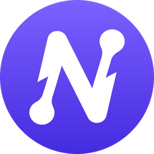
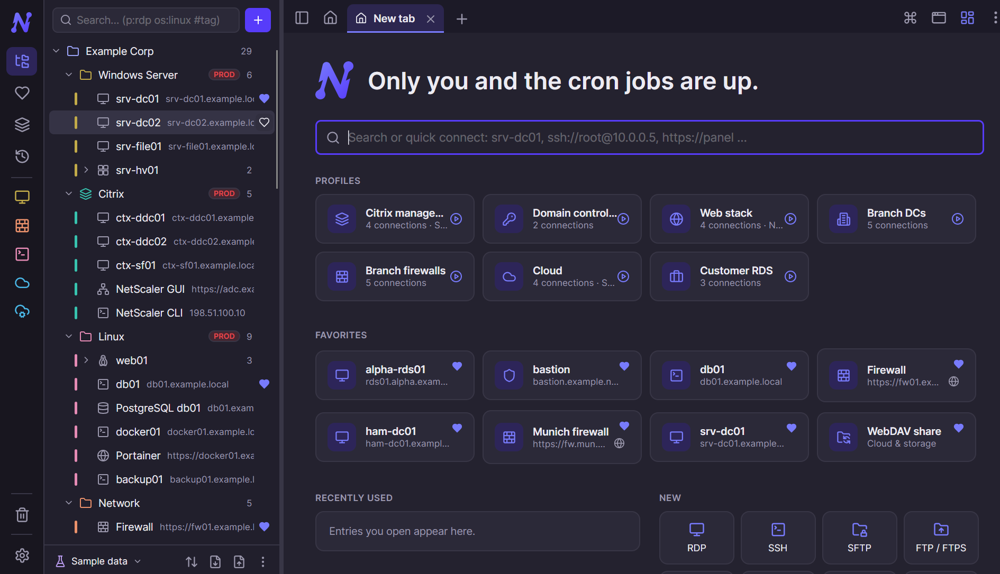

# Nexode RDM

**A modern, open-source remote connection manager for admins in one place for servers, hosts, web panels and credentials.**

Nexode keeps all your **RDP, SSH, SFTP, SCP, FTP/FTPS, WebDAV, S3, VNC, Telnet, serial, PowerShell, web panel, command and database** connections in one **tree of folders and hosts** – and opens them right inside the app: remote desktops, terminals and file transfers run in **browser-like tabs**, in as many **windows** as you like. Folders **pass on** credentials, domain, environment and color to everything below them – a server only needs its host name. Passwords live in an **encrypted vault** (AES-256-GCM, optional master password with Argon2id, optionally the whole data source encrypted).

## What's inside

| Area | Features |
| --- | --- |
| **Sessions** | RDP embedded in a tab on Windows (Linux: FreeRDP, macOS: Windows App) incl. RemoteApp, session shadowing and monitor choice, SSH, Telnet, serial and **PowerShell remoting** terminal (xterm colors, mouse, copy & paste, scrollback), SFTP / SCP / FTP / FTPS / WebDAV / S3 with two panes, toolbar, sortable columns, drag & drop, remote edit and transfer queue, web panels in a **built-in browser**, **jump hosts**, **SSH agent**, optional **folder compare & sync**, VNC viewer with scaling (VeNCrypt/TLS, Apple Remote Desktop, Tight + JPEG), **split view** with up to four sessions (optionally typing into all terminals at once), automatic reconnect, Wake-on-LAN – sessions keep running when you move a tab to another window |
| **Connections** | RDP, SSH, SFTP, FTP/FTPS, VNC, Telnet, serial, PowerShell, web panels, commands, databases, hosts (bundle several connections of one machine), credential profiles, notes – open embedded, in the external program or with one-off parameters |
| **Organization** | **Entry templates** (built-in and your own), bulk edit of many entries, folders with inheritance (credentials, host, environment, color, sorting), **connection profiles** (open a set of machines at once), editable categories, tags, favorites (♥), recent and most used, entries pinned to the menu bar (drag & drop), editable environments (*Production / Staging / Test / Development / Trash* or your own, with colors) |
| **Tree** | Drag & drop (before / into / after, Ctrl = copy), multi-selection, cut / copy / paste, duplicate, undo, trash, natural / manual / type / last-used sorting |
| **Search** | Instant fuzzy search with filters: `p:rdp`, `os:linux`, `env:prod`, `cat:server`, `in:folder`, `#tag`, `is:fav` – and the **command palette** (Ctrl+K) for connections, profiles, actions and settings |
| **Clipboard** | Copy name, host, URL, user, password, domain, `DOMAIN\user`, UPN or a ready command line – passwords are cleared automatically |
| **Vault** | AES-256-GCM per data source; protected by Windows DPAPI or a master password (Argon2id); optionally the whole data source encrypted; lock after inactivity, on minimize, with the screen lock and after sleep; master password before showing passwords; trusted SSH keys and certificates (filter, unused ones, forget); **SSH key generator** with installation on servers; password generator |
| **Tabs & windows** | Home tab with greetings and quick connect (sections configurable), details per entry with **system information** (OS, CPU, memory, drives, uptime), **dashboard with live status** (own window or fullscreen kiosk), connection history, tray icon, settings – reorganize tabs and move them (with running sessions) into new windows |
| **Personalization** | Nexode (default) / Dark / Shadow (medium gray) / AMOLED / Mica (Windows 11 backdrop) / light / Lightweight / follow system / automatic by time or sunrise, any accent color or the system accent, folder colors (also on tabs and rail pins), icons per entry, compact mode, interface size, animations (speed, presets), hints and info cards, optional status bar, start page and autostart, English / German / French / Spanish, **every optional feature switchable** (*Minimal* keeps only the core) |
| **Data** | Several data sources (e.g. *Work* / *Home*) with color and icon, **team data sources** on a shared folder (one editor, everyone else reads along), move or copy entries between them, daily backups with restore, import & export as `.nexode` files (encrypted), **LAN sync** between your own computers (sync password, J-PAKE + AES-GCM), a **local FTP server** to share a folder in the LAN, portable mode |

## Requirements

- **Windows** 10 / 11 or Windows Server 2016 – 2025 (64-bit) · **Linux** Ubuntu 22.04+ / Debian 12+ (x64) · **macOS** 13+ (Intel or Apple silicon).
- Everything is included – no .NET or other runtime to install. The built-in browser uses the web view of the system (Windows: WebView2 – the setup installs it if missing; Linux: WebKitGTK – installed with the `.deb`). Packages: Windows setup or portable ZIP, Linux `.deb` (installs FreeRDP for RDP automatically), macOS app for Intel and Apple silicon. On macOS RDP uses the *Windows App* from the App Store.

## Quick start

1. Download `nexoderdm_vX.Y.Z_setup.exe`, the portable ZIP, the `.deb` or the macOS archive from the [releases](https://github.com/complicatiion/NexodeRDM/releases) and start **Nexode RDM**. Linux: `sudo apt install ./nexoderdm_vX.Y.Z_amd64.deb`.
2. **Import** a `.nexode` file or take over your connections with **Settings → Data → Import from other tools** (mRemoteNG, RDCMan, `.rdp`, PuTTY, `~/.ssh/config`, WinSCP, MobaXterm, Remmina). To look around first: **Settings → Integration → Sample data → Add** (its own data source, removable with one click).
3. Create your structure with **+** (top left): a folder for each customer or site, set **Credentials → Own credentials** on the folder, then add hosts and connections – they inherit the credentials.
4. Double-click a connection to open it in a tab. Right-click any entry for everything else: open external or with parameters, copy fields, pin, add to a profile, Wake-on-LAN, color, icon, category, environment, sorting, move to another data source, export.
5. Machines you always need together: **Profiles** in the left menu → **+** → choose the connections and *Open as split view*.
6. Optional: **Settings → Security → Set master password** – and if you like, **Encryption → Whole data source**.

## Sessions

| Type | In Nexode |
| --- | --- |
| **RDP** | Windows: embedded Microsoft Remote Desktop client (NLA, gateway, admin session, clipboard, drives, printers, audio, dynamic resolution). Linux: FreeRDP window, macOS: Windows App – the password is handed over without appearing on the command line. |
| **SSH** | Terminal with 256 / true colors, mouse support, scrollback, copy on select (optional), font size per tab; password, key file (OpenSSH, PuTTY `.ppk`, with passphrase) and keyboard-interactive (one-time codes). **SFTP** button opens the file browser for the same host. |
| **Telnet** | Same terminal, window size and terminal type are sent, optional automatic login. |
| **SFTP / SCP / FTP / FTPS** | Two panes (this computer / server) with a toolbar, sortable columns and a filter; upload and download with drag & drop, folders included, transfer queue on its own connection, cut / copy / paste, rename, delete, new folder or file, properties with Unix permissions (chmod), **edit remote files** – every save is uploaded again. FTPS explicit and implicit, passive mode. |
| **WebDAV / S3** | Same file browser for WebDAV shares (Nextcloud, ownCloud, IIS …; Basic, Digest, NTLM) and S3 storage (AWS, MinIO, Wasabi, Backblaze B2, Ceph – Signature V4, multipart upload). |
| **Web panels** | Built-in browser in a tab (WebView2 / WebKit of the system): address bar, back / forward, zoom, optional HTTP Basic login or form fill, self-signed certificates per panel (Windows), cookies per data source. One click opens the same page in your default browser. |
| **VNC** | Remote screen scaled to the tab or 1:1, keyboard and mouse, Ctrl+Alt+Del, send clipboard text, view only. Classic VNC password authentication. |
| **PowerShell** | Remote PowerShell (`Enter-PSSession`) in a tab: WinRM over HTTP (5985) or HTTPS (5986), Negotiate / Kerberos / CredSSP, JEA endpoints, or PowerShell 7 over SSH. Windows uses Windows PowerShell or PowerShell 7, Linux / macOS need PowerShell 7 (`pwsh`). The password is typed into PowerShell's own prompt – never on the command line. |
| **Serial** | Console cable (COM port / USB adapter): speed, data bits, parity, stop bits, flow control, line ending, local echo – same terminal as SSH. Linux: your user must be in the group `dialout`. |

**Jump hosts:** *Connect via* an SSH entry tunnels RDP, SSH, SFTP, SCP, VNC, Telnet, WebDAV, S3 and web panels through that server. **Live status** shows green / red dots for reachable connections in the tree and on the dashboard. **Connection history** records what was opened when.

**Split view:** right-click a session tab → *Split view*, or open a profile as split view – up to four sessions side by side, one above the other or 2 × 2. **Automatic reconnect** retries a dropped connection with a countdown. **Wake-on-LAN** wakes a host (MAC address in the editor) and connects once it answers.

**Send to all:** in a split view with several terminals, *Send to all* types into every terminal at once – the receiving panes get a red frame as long as it is on.

**Remote Desktop extras:** *RemoteApp* opens just one program of the server (alias `||name` or path) as its own window; *Files via clipboard* can be switched off (text only).

The first connection to a server shows its **SSH key fingerprint** or **certificate**; after you trust it, Nexode warns you if it ever changes. Trusted servers are listed under **Settings → Security** – with a filter, the date they were trusted and a hint when no entry uses them any more.

## SSH keys

**Settings → Security → SSH keys** (or *Keys …* next to the key file of an SSH entry, or right-click an SSH entry → *Install SSH key …*):

1. **Generate** an Ed25519 or RSA key (OpenSSH format, optional passphrase) – it is saved where you choose, readable only by you, with a `.pub` file next to it. Or pick an **existing** key.
2. **Install** the public key on a server: Nexode connects with the entry's stored credentials and adds the key to `~/.ssh/authorized_keys` (once, like `ssh-copy-id`). Optionally the entry uses the key from then on.

## Features on and off

**Settings → Features** lists every optional part of Nexode with its own switch: connection types (VNC, Telnet, serial, PowerShell, web panels, WebDAV/S3, databases, commands), tools (dashboard and live status, status dots in the tree, folder compare & sync, Wake-on-LAN, SSH agent, SSH key tools, send to all terminals), split view, command palette and team data sources. A switched-off feature disappears from menus, the editor and the home page and stops its background work. **Nothing is deleted:** entries of a switched-off type stay in the tree (dimmed) and keep working for colleagues in a team data source. *Minimal* keeps only RDP, SSH and file transfer (plus split view and command palette); *Default features* brings everything back.

## Diagnostics

**Settings → Diagnostics** shows what Nexode finds on this computer – version, portable mode, data folder, theme and Mica, system accent, SSH agent, RDP client, PowerShell, web engine, serial ports, live status – and the last lines of the log. *Copy report* puts it on the clipboard for a support request; it contains no host names, users or passwords.

## Keyboard

| Keys | Action |
| --- | --- |
| `Ctrl+T` / `Ctrl+W` / `Ctrl+Shift+T` | new tab / close tab / reopen closed tab |
| `Ctrl+Tab`, `Ctrl+1…9` | switch tabs |
| `Ctrl+Shift+N` | new window |
| `Ctrl+F` / `Ctrl+K` / `Ctrl+Shift+K` | search the tree / command palette / start page with quick connect |
| `Ctrl+N` | new entry |
| `Enter` / `Space` / `F2` / `Del` | open / details card / rename / delete |
| `Ctrl+C`, `Ctrl+X`, `Ctrl+V`, `Ctrl+D` | copy, cut, paste, duplicate entries |
| `Ctrl+Z` / `Ctrl+L` / `Ctrl+B` | undo / lock vault / show or hide the tree |
| Terminal: `Ctrl+Shift+C` / `Ctrl+Shift+V`, `Shift+PgUp/PgDn`, `Ctrl` `+`/`-` | copy / paste, scroll back, font size |
| Split view: `Ctrl+Alt+←` / `→` | previous / next pane |
| `Ctrl+E` (several selected) | bulk edit |
| `F11` | fullscreen kiosk (window without tabs and menus) |
| File browser: `F2`, `Del`, `F5`, `F7`, `Ctrl+A/C/X/V`, `Alt+Enter`, `Backspace` | rename, delete, refresh, new folder, select / copy / cut / paste, properties, up |

## Import & export

**Settings → Data** exports the whole data source or a selection as a **`.nexode`** file: without passwords, **fully encrypted** (recommended) or with readable structure and encrypted passwords (for Git). Theme and settings can be exported too. Double-click a `.nexode` file or drop it on Nexode to import it – with a preview, conflict handling (skip, overwrite, newer wins, keep both) and a backup before every import.

**Import from other tools:** mRemoteNG (`confCons.xml`, also with master password), Remote Desktop Connection Manager (`.rdg`), `.rdp` files, PuTTY sessions, the OpenSSH `~/.ssh/config`, WinSCP (registry or `WinSCP.ini`), MobaXterm (`MobaXterm.ini` / `.mxtsessions`) and Remmina (`*.remmina`). Passwords are taken over where possible (RDCMan and `.rdp` passwords only on the same Windows account, WinSCP only without its master password, MobaXterm never). Importing the same file again shows the entries as *identical* instead of duplicating them.

## Team data source

**Settings → Data → Team data source** puts a data source into a shared folder (network share, NAS). Everyone opens it with the same master password. One person edits at a time, everyone else sees who is editing and gets the changes within seconds; favorites, pins and recent connections stay personal. When the editor closes Nexode, the next one can take over with *Edit*.

## Portable mode

Put an empty file named `portable.mode` (or `nexode.portable`) next to the program – the portable ZIP already contains it. All data then stays in the `data` folder next to Nexode, a master password is required so the passwords stay readable on every computer, and Nexode changes nothing on the computer it runs on (no autostart, no file type registration).

## Uninstall

- **Setup:** *Windows Settings → Apps → Nexode RDM* – the uninstaller asks whether your data should be deleted.
- **Portable / Linux / macOS:** delete the program folder and, if you like, the data folder (see [licenses/PRIVACY.md](licenses/PRIVACY.md)).

## Privacy

Everything runs locally: no account, no telemetry, no automatic network access – Nexode only connects to the servers you open. Data: `%AppData%\Nexode`, `~/.local/share/Nexode` or `~/Library/Application Support/Nexode` (portable: `data` next to the app). Details: [licenses/PRIVACY.md](licenses/PRIVACY.md).

## Important notes

- **Keep your master password safe.** Without it the stored passwords – and with full encryption the whole data source – cannot be recovered.
- On **Linux and macOS** Nexode does not use the system key store yet – set a master password there.
- **macOS:** the app is not notarized by Apple. On first start: *System Settings → Privacy & Security → Open anyway*.
- **Team data sources** need a master password that everyone in the team knows – pass it on securely, not by email.
- Check a server's key or certificate fingerprint before you trust it for the first time. A *changed key* warning can mean a reinstalled server – or an attack.
- Exports without passwords still show host names and the structure of your infrastructure – store them carefully.
- Imported *Command* entries stay disabled until you mark them as reviewed.

## Credits

The interface is made with **[Avalonia UI](https://avaloniaui.net/)** and **[CommunityToolkit.Mvvm](https://github.com/CommunityToolkit/dotnet)** on **[.NET](https://dotnet.microsoft.com/)**. SSH and SFTP: **[SSH.NET](https://github.com/sshnet/SSH.NET)**. Data sources use **[SQLite](https://sqlite.org)**, **[Bouncy Castle](https://www.bouncycastle.org/)** for Argon2id and Ed25519 keys. Terminal, FTP/FTPS, VNC, Telnet, serial, PowerShell launcher, SSH key format and Wake-on-LAN are Nexode's own implementations. Icons: **[Lucide](https://lucide.dev)**, font: **[Inter](https://rsms.me/inter/)**. Licenses: [licenses/README.md](licenses/README.md).

## Project & Copyright

Nexode RDM is a personal software project by **Sven Klocke** (*sksdesign | complicatiion*).

**Project repository:** [github.com/complicatiion/NexodeRDM](https://github.com/complicatiion/NexodeRDM)  
**Website:** [sksdesign.de](https://sksdesign.de)

Nexode RDM is released under the **MIT License** ([LICENSE.md](LICENSE.md)). It is provided without warranty; liability is limited to the extent permitted by law – see [licenses/LEGAL-NOTICE.md](licenses/LEGAL-NOTICE.md) and [licenses/COPYRIGHT.md](licenses/COPYRIGHT.md). Third-party components keep their own copyrights and licenses: [licenses/README.md](licenses/README.md).

Note: Windows, macOS, Linux and all other names are trademarks of their respective owners. Nexode uses generic symbols and is not affiliated with or endorsed by them.
